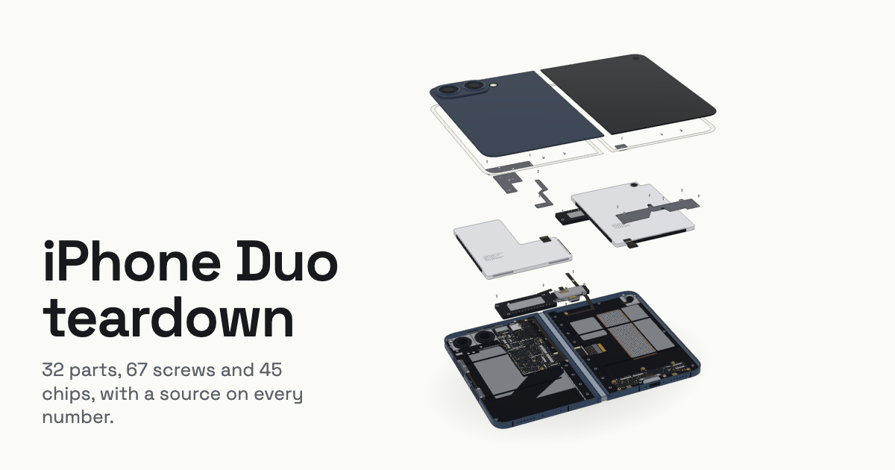

# iPhone Duo teardown

An interactive 3D teardown of Apple's iPhone Duo, the first folding iPhone, built entirely from code. Press play and the
phone comes apart in repair order: 32 parts, 67 screws and 45 chips, each with a source for every number on screen.

**Live:** [protomota.com/experiments/iphone-duo-teardown](https://protomota.com/experiments/iphone-duo-teardown)
· **Video:** [youtu.be/bnFi0pPcMdE](https://youtu.be/bnFi0pPcMdE)



There are no photos, no 3D model files and no Apple or iFixit artwork in this repo. Every part, screw, chip, cable and
board is drawn with [three.js](https://threejs.org/) from numbers in plain JavaScript, and the whole page builds to a
single self-contained HTML file under 1 MB that makes no outside requests.

Not affiliated with, authorized or endorsed by Apple or iFixit.

## What it does

- **Auto tour.** The page opens on the sealed phone and plays the teardown on its own: the chapters follow
  [iFixit's teardown video](https://www.youtube.com/watch?v=WOVIjFnivJA), and the order of the small parts inside each
  chapter follows Apple's repair procedures. At the end the phone goes back together.
- **Take over at any time.** A click, tap, scroll or key press hands control to you. Drag the slider from sealed to
  fully exploded, pick a part from the list to isolate it, or switch camera views.
- **Sourced panels.** Each part shows its facts with a link to where they came from. Boards list every chip and screw
  they carry; picking a chip turns the phone to show it and draws a leader line to it. Numbers nobody has published are
  left blank and listed at the bottom of the page instead of being estimated.
- **Works everywhere.** Desktop and phone layouts, keyboard control, `prefers-reduced-motion` (no auto tour), and a
  fallback that keeps the parts list and sources working when WebGL is off.

## How it's built

The phone is a set of pure functions of one number, teardown progress `p`, from 0 (sealed) to 1 (fully exploded).
Geometry, camera, labels, panels and the tour all read from the model, and nothing else keeps a position or a number of
its own. Change a fact in one place and every panel follows.

| File | What it holds |
|---|---|
| `src/model.js` | The model: sizes, every pose, the hinge, camera views and the tour, as functions of `p`. No three.js, no DOM, no clock. |
| `src/hardware.js` | Every screw Apple's repair manual names (part number, torque, position) and every chip iFixit's chip ID names, plus board outlines. |
| `src/sources.js` | The citations. A fact that points at a source missing from this list fails the tests. |
| `src/phone.js` | Builds the phone in three.js from the model and poses it with `update(p)`. |
| `src/boards.js` | The logic board and I/O board with their shields off: land patterns, connectors and the passives around the chips. |
| `src/brackets.js` | Adhesive sheets, cowlings, antenna flex cables, the spacer, microphone and side buttons. |
| `src/pieces.js` | All screws and chips as instanced meshes, so they cost a handful of draw calls. |
| `src/shapes.js` | Shape helpers and materials; merges each part's geometry by material. |
| `src/stage.js` | The renderer, lighting and soft shadow. |
| `src/ui.js` | Everything outside the canvas: parts list, panels, specs, sources, slider. |
| `src/main.js` | The loop. The tour reads the model directly; live input only sets targets that the page eases toward. |
| `src/index.html`, `src/style.css` | The page shell and styles. `build.mjs` inlines fonts, styles, script and logo into it. |

Shapes and positions are traced by eye from iFixit's photos and Apple's service diagrams, so they place parts but are
not measurements. The hinge is the exception: its two pivot points are worked out from Apple's published open and
closed sizes so the model lands on both.

## Running it

Requires Node 20 or newer.

```bash
npm install
npx playwright install chromium   # once, for the card and the browser checks
npm test                          # 31 tests
npm run release                   # builds dist/index.html and dist/duo-card.png
```

Then open `dist/index.html` in a browser. It's one file, so you can also serve the `dist/` folder from anywhere.

| Command | What it does |
|---|---|
| `npm test` | Checks the model (published sizes, order, sources, tour), walks every vertex at 25 fold angles to prove no part leaves the body, and proves no two surfaces tie for depth |
| `npm run build` | Builds the page alone into `teardown-out/dist/duo-live.html` |
| `npm run release` | Builds the page and renders the 1200 × 630 share card from it, then copies both into `dist/` |
| `npm run check` | Drives the built page like a visitor at desktop and phone sizes (34 checks). Its timing checks need a real GPU; in a software-rendered headless browser a few of them fail on speed alone |
| `node tools/fit.mjs` | Runs the body check alone and names any part that pokes out, by how many millimetres |
| `node tools/zfight.mjs` | Runs the depth check alone and names any two surfaces sharing a plane at four poses |
| `node tools/flicker.mjs` | Renders every tour step twice and counts the pixels that flip |
| `node tools/cost.mjs` | Prints draw calls, triangles and script time per frame |
| `node tools/timeline.mjs` | Prints the tour's timeline |

To use a Chrome or Chromium you already have instead of Playwright's, set `CHROMIUM_PATH` to its executable.

### Hosting your own copy

The share card needs the page's full address. Build with yours, ending in `/`:

```bash
SITE_URL=https://example.com/iphone-duo-teardown/ npm run release
```

Upload `dist/index.html` and `dist/duo-card.png` into one folder. The page is designed to fill a screen, so if you embed
it in another page, give the frame the full height:

```html
<iframe src="/iphone-duo-teardown/" title="iPhone Duo teardown" style="display:block;width:100%;height:100svh;border:0" loading="lazy"></iframe>
```

### Recording it

The page has a deterministic capture mode for frame-by-frame video. Set `window.__CAPTURE = true` before the page loads,
then call `window.SIM.render(t)` to draw the tour at `t` seconds (`window.SIM.duration` is the tour's length) and take a
screenshot per frame. That's how the [video](https://youtu.be/bnFi0pPcMdE) was made, at 4K60.

## Sources

Apple's tech specs, press release, repair manual, exploded views, screw diagrams and repair procedures; iFixit's
teardown, teardown video, chip ID, device page and repair price comparison; and MacRumors on Apple's EU battery label.
The full list with links is in [`src/sources.js`](src/sources.js) and at the bottom of the page.

## License

The code in this repository is released under the [MIT License](LICENSE).

Some things in it are not covered by MIT:

- **Teardown findings from iFixit.** The teardown order, chip identifications and other findings come from
  [iFixit](https://www.ifixit.com/), whose content is licensed
  [CC BY-NC-SA 3.0](https://creativecommons.org/licenses/by-nc-sa/3.0/). The page restates them in new words, and the
  text drawn from them stays under CC BY-NC-SA 3.0: credit iFixit, don't use it commercially, and share changes under
  the same license. Keep the credit line and the "not affiliated" line on the page.
- **The Protomota name and logo** (`src/protomota-logo.png`, and the Protomota header and footer in `src/index.html`)
  are not licensed for reuse. Swap them for your own if you host a copy.
- **Bundled third-party code.** The built page inlines [three.js](https://github.com/mrdoob/three.js) (MIT),
  [Space Grotesk](https://github.com/floriankarsten/space-grotesk) and
  [JetBrains Mono](https://github.com/JetBrains/JetBrainsMono) (both SIL Open Font License 1.1).
- **Trademarks.** Apple and iPhone are trademarks of Apple Inc. iFixit is a trademark of iFixit. Naming them here
  doesn't imply any endorsement.

---

Made by [Brad Dunlap](https://protomota.com/) at Protomota.
